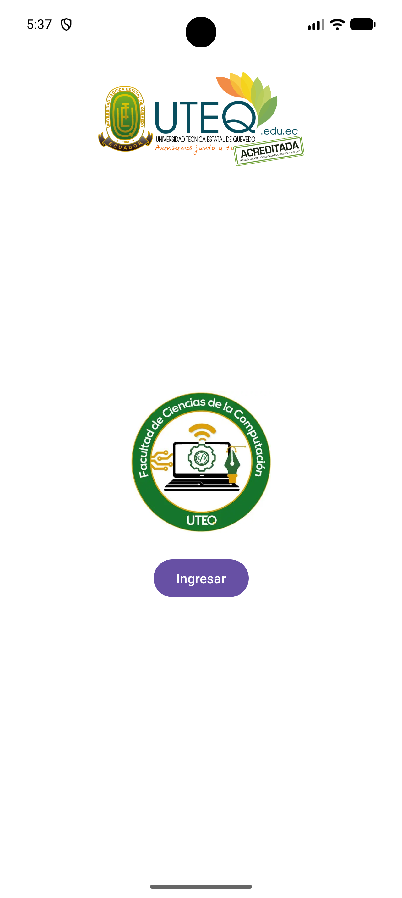
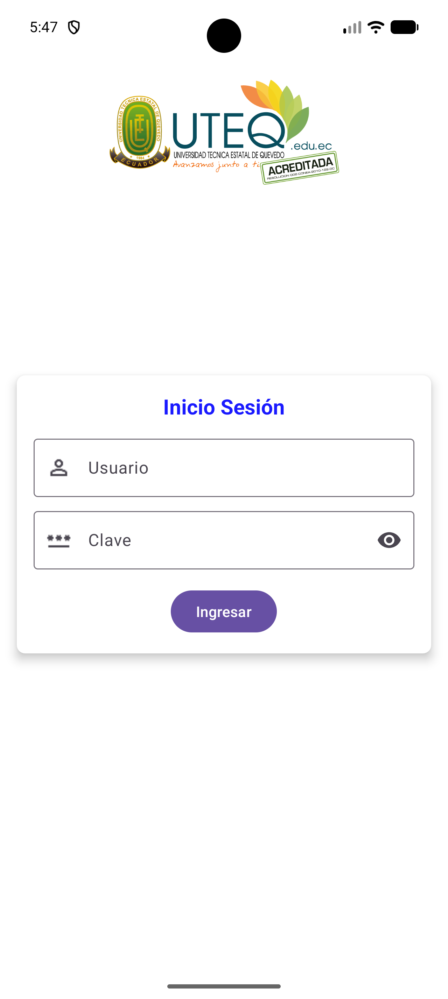

# Práctica 1: Bienvenida y Login (UTEQ)

App Android con dos pantallas, una de **Bienvenida** y otra de **Inicio de Sesión**, basadas en la identidad visual de la UTEQ y de la Facultad de Ciencias de la Computación.
Esta práctica es **solo de diseño**: las pantallas se ven completas, pero los botones no realizan acciones y no hay validaciones programadas.

## Capturas

<table>
  <tr>
    <th>Bienvenida</th>
    <th>Login</th>
  </tr>
  <tr>
    <td></td>
    <td></td>
  </tr>
</table>

## Pantallas

### Bienvenida (`MainActivity` / `activity_main.xml`)
- Logo de la UTEQ en la parte superior.
- Logo de la Facultad de Ciencias de la Computación centrado.
- Botón **Ingresar** (Material 3, redondeado).

### Login (`Login` / `activity_login.xml`)
- Logo de la UTEQ en la parte superior.
- Tarjeta (`MaterialCardView`) con sombra y esquinas redondeadas, que contiene:
  - Título **Inicio Sesión** en azul.
  - Campo **Usuario** (`TextInputLayout` outlined) con ícono de persona.
  - Campo **Clave** con ícono de contraseña y **botón de ojo para mostrar u ocultar la clave** (`app:endIconMode="password_toggle"`, no requiere código).
  - Ambos campos se marcan como obligatorios (`Usuario *`, `Clave *`), con un texto de ayuda debajo: *Nombre requerido* y *Clave requerida*.
  - Botón **Ingresar**.

> La captura de Login se tomó antes de agregar los asteriscos y los textos de ayuda.

## Configuración actual
- Al abrir la app se muestra el **Login**, porque el `intent-filter` LAUNCHER está en `Login` dentro de `AndroidManifest.xml`.
  Para que vuelva a iniciar en la Bienvenida, mueve el `intent-filter` a `MainActivity` y cambia `android:exported` en las dos Activities.
- El botón "Ingresar" de la Bienvenida **no** abre el Login, y el de Login **no** valida los campos.

## Archivos principales
| Archivo | Contenido |
|---|---|
| `app/src/main/res/layout/activity_main.xml` | Diseño de la Bienvenida |
| `app/src/main/res/layout/activity_login.xml` | Diseño del Login |
| `app/src/main/res/values/strings.xml` | Textos (Ingresar, Inicio Sesión, Usuario, Clave, mensajes de ayuda) |
| `app/src/main/res/values/colors.xml` | Color del título (`azul_titulo`) |
| `app/src/main/res/drawable/` | `icon_principal.png` (UTEQ), `oip.jpg` (Facultad), `person.png`, `pass.png` |
| `app/src/main/AndroidManifest.xml` | Declaración de Activities y pantalla de inicio |
| `app/src/main/java/.../MainActivity.java`, `Login.java` | Solo cargan su layout, sin lógica |

## Tecnologías
- Java 11, Android Gradle Plugin 9.5.1
- `minSdk` 24, `targetSdk` / `compileSdk` 37
- Material Components 1.14 (Material 3), ConstraintLayout, View Binding

## Cómo ejecutarlo
1. Abre la carpeta `Practica1_Bienvenida` en Android Studio.
2. Espera a que termine la sincronización de Gradle.
3. Elige un emulador o dispositivo y presiona **Run ▶**.
